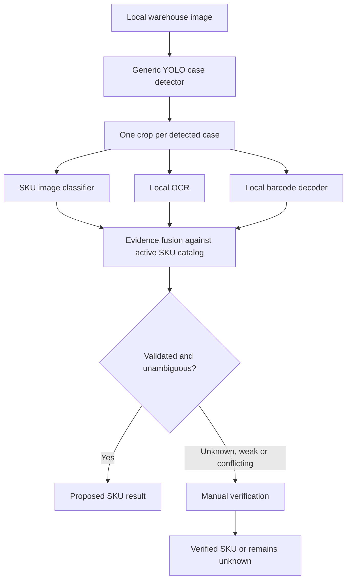

# DistributionOS SKU architecture

## What works now

The Streamlit sidebar opens on Inventory dashboard, with Product catalog, Inventory & image upload, Manual verification and Dataset workflow also available. The permanent dashboard connects every catalog SKU to its stock ledger. The old three-brand manual test table, its saved-session CSV, and future-AI template remain compatible as a separate sandbox. No model, detector, OCR engine or barcode engine is installed or called by the UI.

The catalog and permanent ledger use one local SQLite file (`local_data/catalog.sqlite3`, ignored by Git). It stores SKU metadata, normalized reference JPEGs and stock movements. This embedded file requires no separate server or paid service. Set `DISTRIBUTIONOS_DATA_DIR` to select a different local directory. Back up that directory while the app is stopped. Catalog records, photos and ledger quantities persist across restarts; only the legacy sandbox and photo reviews remain temporary. Run on your own computer for private warehouse images.

## Permanent inventory ledger

`distributionos/ledger.py` adds `inventory_movements` and `inventory_ledger_meta` without altering catalog tables. Before any DDL, it checks integrity/known structure, takes a SQLite backup under a reserved write lock and verifies that the backup's product/photo rows match exactly. DDL and version metadata commit atomically. Backup failure, unknown schema/version or integrity failures block upgrade. No catalog row is rewritten or deleted, and no temporary brand-level quantities are imported. The upgrade snapshot is not an ongoing backup of later transactions.

Every movement references a stable SKU and records a unique request ID, UTC timestamp, product-name snapshot, movement type, integer case quantity and notes. Opening stock is allowed once, including zero; subsequent Stock In/Out must be positive. Current stock is the sum of opening and incoming quantities minus outgoing quantities. A left join includes every catalog product, with a separate opening-set flag to distinguish an unknown starting quantity from a confirmed zero. Inactive products and their stock/history remain visible.

`BEGIN IMMEDIATE` serializes validation and insertion so simultaneous sessions cannot oversell. Idempotency keys prevent a retried save request from inserting twice. Database constraints/triggers enforce one opening per SKU, opening before subsequent movements, nonnegative stock, and append-only history. Application validation bounds quantities and balances to 2,147,483,647 cases. Corrections use reversing movements rather than editing or deleting the audit trail. Stock date is the actual save time; arbitrary backdating is not supported.

`distributionos/inventory_screen.py` presents the permanent dashboard, opening-stock form, movement form, history and inventory/history CSV downloads. `distributionos/exports.py` shares Excel-safe CSV generation with the old sandbox. There is no automated AI-to-stock write path. The catalog continues to manage product metadata without creating movements; a new product automatically appears awaiting opening stock. Use the same data folder across restarts and code updates. See README for backup and upgrade instructions.

Each SKU has an immutable normalized code, brand, product name, package size per unit, positive bottles/cans per case, packaging type, optional unique barcode string, active flag and UTC update time. Photos are linked one-to-many by SKU. Barcode strings preserve leading zeros; use the exact scanned code and check whether it identifies a single bottle or outer case. The current schema supports one barcode per SKU; aliases and multiple packaging-level codes can be added later in a separate mapping table. Do not invent barcode values.

No catalog is prefilled: the three original brand labels do not tell us the actual sizes, case packs or product codes. Add those from the warehouse. Duplicate product names across sizes are allowed; duplicate SKU codes and barcodes are rejected. Deactivate obsolete SKUs instead of deleting history. There is no fixed class count or 100-SKU cap; tests exercise 120 distinct SKUs. Local photo storage and machine memory determine practical scale.

## Planned recognition flow

`distributionos/recognition.py` defines detector, classifier, text-reader and barcode-reader protocols plus the orchestration and fusion rules. These are contracts with synthetic tests, not usable recognition adapters. A future YOLO adapter outputs only generic `case` boxes in EXIF-oriented image pixel coordinates; SKU count never changes its detection class list. It must not confuse individual bottles with cases. The classifier has a separate vocabulary keyed by exact SKU codes. Adding catalog records does not automatically teach a classifier new products: new classes need labeled examples, model updates and evaluation.

OCR contributes readable product and size text; brand-only text cannot determine a SKU. Barcodes are matched exactly to the catalog; unknown codes or evidence disagreement require review. Known classifier scores, detection confidence, classifier margin and OCR agreement are checked independently. The sample thresholds (0.90 classifier, 0.15 margin, 0.50 detector) are uncalibrated development defaults. Automatic acceptance is OFF even when scores are high. Enable it only after representative held-out evaluation, barcode-level mapping checks and confidence calibration. Softmax scores are not proof of correctness.

Unknown classifier labels, missing evidence, inactive SKUs, unknown or multiple barcodes, conflicting text and low detection confidence produce `needs_review`, not a guessed SKU. No detection is not evidence of an empty warehouse. Missed, overlapping and partially visible cases need detector evaluation; a detector result is not a verified physical inventory count. A future adapter failure should stop that run with a visible error, never silently fabricate results.

The current UI can send an uploaded whole photo to a session-only review queue. A person may assign one active SKU or leave it unknown/mixed. This is not a detected case and does not update inventory or become a training label automatically. Future per-case pipeline results include crop, bounding box, evidence, reason and candidate SKU; wire them to the same review concepts when real adapters exist. Preserve source image/case IDs, reviewer decisions, model/catalog versions and an audit trail before production use. Never double-count pending or rejected cases. A future SKU inventory should aggregate only reviewed/accepted case IDs, separately from this legacy manual sandbox.

## Local, low-cost implementation path

1. Collect real SKU catalog and reference views.
2. Label warehouse cases and SKU crops using the dataset workflow.
3. Evaluate a generic case detector independently of SKU accuracy.
4. Add local classifier, OCR and barcode adapters (possible tools: a YOLO implementation, PyTorch classifier, Tesseract/PaddleOCR, ZXing). Check model/dataset licenses, including YOLO distribution obligations, before choosing packages or shipping.
5. Evaluate unknown rejection, similar-size variants, case counts, occlusion, barcode level and manual-review rate on held-out capture groups. Calibrate thresholds per SKU where needed.

No training command, paid endpoint, cloud upload, model download or deployment is included in this change. The only runtime dependencies remain Streamlit and Pillow plus Python's standard library.
